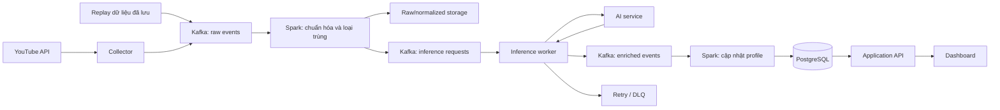

# Kiến trúc hệ thống đề xuất

## Tổng quan

**Lựa chọn hiện tại:** Served AI với hàng đợi inference. Spark tạo yêu cầu; worker gọi AI service và phát kết quả. Luồng này tránh giữ một lời gọi model chậm trong từng hàng xử lý Spark. Đây là thiết kế mục tiêu, chưa được triển khai.

## Trách nhiệm thành phần

| Thành phần | Trách nhiệm |
| --- | --- |
| Collector | Poll dữ liệu, phân trang, lưu tiến độ, backoff khi lỗi/quota, xuất sự kiện có version |
| Kafka | Đệm tải, giữ sự kiện để replay và tách tốc độ thu thập khỏi tốc độ inference |
| Spark chuẩn hóa | Kiểm tra schema, chuẩn hóa, loại trùng, lưu dữ liệu, tạo yêu cầu AI |
| Inference worker/service | Batch khi phù hợp, timeout/retry, xác thực output, xuất kết quả có version |
| Spark profile | Tổng hợp theo KOL/thời gian, cập nhật kết quả và kiểm soát trùng |
| PostgreSQL | Lưu nội dung, tuple AI, snapshot tương tác và dữ liệu phục vụ dashboard |
| Storage | Giữ raw/normalized data và dữ liệu thực nghiệm; bắt đầu bằng file Parquet/JSONL |
| API/dashboard | Truy vấn profile, thay đổi theo thời gian, trạng thái xử lý và dẫn chứng |

FastAPI, PostgreSQL và Docker Compose là lựa chọn triển khai đề xuất. Phiên bản cụ thể sẽ được khóa khi tạo code. Airflow chỉ bổ sung khi có nhu cầu điều phối backfill, đánh giá hoặc lịch tác vụ nhiều bước.

## Hợp đồng sự kiện

Mỗi event có `schema_version`, `event_id`, `event_type`, `source`, `source_id`, `creator_id`, `event_time`, `observed_at`, `ingested_at`, `run_id`, `mode` và `payload`.

- `event_time`: thời gian nội dung/sự kiện ở nguồn; snapshot tương tác dùng thời gian quan sát.
- `observed_at`: thời điểm collector quan sát; `ingested_at`: thời điểm nhận vào pipeline.
- `mode`: `live` hoặc `replay`; `run_id` tách các lần thực nghiệm.
- `event_id`: định danh ổn định cho cùng sự kiện hoặc cùng phiên bản nguồn khi retry; không tạo UUID mới cho mỗi lần gửi lại.
- Output AI thêm `input_version`, `model_version`, `taxonomy_version`, `processed_at` và `status`.

Topic đề xuất: `content.raw`, `comments.raw`, `engagement.raw`, `ai.requests`, `ai.results`, `pipeline.dlq`. Tách topic thêm chỉ khi thực nghiệm cho thấy cần thiết.

## Tính đúng và phục hồi

1. Không giả định exactly-once xuyên Kafka, service và database. Thiết kế theo hướng at-least-once với idempotent sink.
2. Unique key theo nguồn/nội dung/phiên bản; kết quả AI theo đầu vào và phiên bản model. Retry dùng cùng khóa.
3. Lưu kết quả canonical trước khi cập nhật aggregate. Khi phân tích lại hoặc sửa bình luận, thay thế đóng góp cũ hoặc tính lại cửa sổ liên quan; không cộng dồn mọi phiên bản.
4. Dùng checkpoint riêng cho từng query; checkpoint không nằm trong thư mục tạm bị xóa khi restart.
5. Đề xuất thử cửa sổ 1 giờ, 1 ngày và profile 7 ngày. Chốt watermark sau khi đo phân bố độ trễ; kiểm tra cách timestamp output AI ảnh hưởng đến sự kiện đến muộn.
6. Lưu raw events độc lập với aggregate. Sự kiện quá muộn được ghi nhận để reconciliation/backfill; không tuyên bố watermark đảm bảo thu nhận mọi sự kiện.
7. Retry có giới hạn, backoff và DLQ có mã lỗi. Không retry vô hạn lỗi schema hoặc input không hợp lệ.

## Snapshot tương tác

Lưu `video_id`, `observed_at`, `view_count`, `like_count`, `comment_count` nếu có. Mức tăng là chênh lệch giữa hai snapshot, kèm độ dài khoảng đo. Giá trị thiếu không đổi thành 0; chênh lệch âm được giữ và đánh dấu để xem xét điều chỉnh từ nguồn.

## Khả năng mở rộng

- Tăng partition và worker theo số liệu tải; theo dõi lệch tải nếu một KOL có lượng comment vượt trội.
- Tách tài nguyên Spark và inference; batch inference và cache theo nội dung/phiên bản.
- Dữ liệu media đi qua storage URI; không đưa file video lớn trực tiếp vào Kafka.
- Khi tăng tải, đo bottleneck ở collector/quota, Kafka, Spark, model và database. Chỉ khẳng định khả năng mở rộng trong phạm vi cấu hình đã đo.
