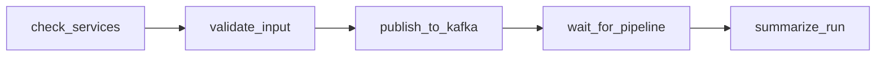

# Điều phối bằng Airflow

## Phạm vi

Airflow điều phối các công việc hữu hạn: kiểm tra đầu vào, phát dữ liệu, chờ kết quả và ghi nhận một lượt xử lý. Kafka, Spark và inference worker tiếp tục chạy như service streaming. Collector thật, backfill và workflow đánh giá model sẽ được bổ sung thành DAG hoặc task sau khi có dữ liệu.

Hiện dùng **Airflow 3.1.8, LocalExecutor**, tối đa hai task đồng thời, một DAG run hoạt động. Mỗi thành phần có container riêng:

- `airflow-postgres`: metadata database, tách khỏi PostgreSQL của ứng dụng.
- `airflow-init`: migration và khởi tạo tài khoản local; chạy lặp không reset mật khẩu.
- `airflow-api-server`: UI/API tại <http://localhost:8080>.
- `airflow-scheduler`: lập lịch và thực thi task qua LocalExecutor.
- `airflow-dag-processor`: đọc và đăng ký DAG.

## Khởi động

```powershell
docker compose up -d --build
docker compose ps -a
docker compose logs --tail 60 airflow-init airflow-api-server airflow-scheduler airflow-dag-processor
```

Lần đầu cần tải image Airflow và migration metadata. Hệ thống này dùng chung máy với Spark; đề xuất bắt đầu với ít nhất 8 GB RAM dành cho Docker và theo dõi mức dùng thực tế.

Đăng nhập UI bằng user `admin`; mật khẩu khởi tạo lấy từ `AIRFLOW_ADMIN_PASSWORD`, mặc định local là `airflow_local_dev`. `.env.example` có các biến cấu hình. File mật khẩu được giữ trong volume `airflow-auth`; sửa biến môi trường sau lần khởi tạo không tự thay mật khẩu hiện có.

SimpleAuthManager và các giá trị mẫu phục vụ phát triển local. Cổng UI chỉ bind localhost. Image Airflow quản lý dependency riêng, không cài cả dependency Spark/API vào môi trường Airflow. DAG dùng module project qua bind mount read-only.

## DAG `kol_replay_pipeline`



1. `check_services`: kiểm tra API và kết nối database ứng dụng qua health endpoint.
2. `validate_input`: xác thực JSONL mẫu, checksum và số event/kết quả AI dự kiến. XCom chỉ lưu manifest, không chứa toàn bộ dữ liệu.
3. `publish_to_kafka`: kiểm tra lại checksum rồi phát qua producer hiện có. Lỗi Kafka làm task thất bại và được retry.
4. `wait_for_pipeline`: sensor chờ đủ raw events, kết quả AI và không còn input chờ phân tích; dùng `reschedule`, mỗi 10 giây kiểm tra một lần, timeout 240 giây.
5. `summarize_run`: kiểm tra lại và đưa thống kê cuối vào XCom/log của task.

DAG có lịch mỗi 15 phút nhưng **pause khi tạo lần đầu**, `catchup=False`, một run đồng thời, timeout toàn run 10 phút, task retry hai lần sau 15 giây. Unpause để scheduler thực thi; pause lại sau khi demo hoàn tất để dừng tạo thêm các lượt replay tổng hợp. Unpause lần đầu có thể tạo ngay một scheduled run; run thủ công sẽ chờ nếu đã có run khác hoạt động.

Run ID ứng dụng có dạng `airflow-<hash>` sinh từ Airflow run ID. Retry hoặc clear task trong cùng DAG run dùng lại run ID và event ID; một DAG run khác được tách riêng. Lấy `run_id` trong XCom của `validate_input` hoặc `summarize_run`, nhập vào dashboard để xem đúng lượt xử lý.

## Trigger và kiểm tra

Sau khi DAG processor đã đăng ký DAG, dùng UI để unpause và trigger, hoặc qua CLI:

```powershell
docker compose exec -T airflow-scheduler airflow dags list-import-errors
docker compose exec -T airflow-scheduler airflow dags list
docker compose exec -T airflow-scheduler airflow dags unpause kol_replay_pipeline
docker compose exec -T airflow-scheduler airflow dags trigger kol_replay_pipeline
docker compose exec -T airflow-scheduler airflow dags list-runs kol_replay_pipeline --output json
```

Đợi các run đã tạo hoàn tất rồi pause lại:

```powershell
docker compose exec -T airflow-scheduler airflow dags pause kol_replay_pipeline
```

Trigger khi DAG đang pause có thể chỉ tạo run ở trạng thái `queued`; run cần được unpause để scheduler thực thi. Lệnh `list-runs` của Airflow 3.1.8 nhận DAG ID dạng positional argument.

## Giới hạn và mở rộng

- DAG hiện điều phối dữ liệu tổng hợp; chưa phải collector YouTube và chưa chứng minh freshness của dữ liệu thật.
- Sensor xác nhận hoàn tất inference và lưu raw snapshots; đây không phải phép đo latency/throughput.
- Sample có thể chứa các retry giống nhau và nhiều snapshot engagement. Với content/comment, workflow yêu cầu một phiên bản cho mỗi source ID để số kết quả dự kiến không mơ hồ.
- Không truyền đường dẫn tùy ý từ UI; DAG dùng file sample cố định. Thêm nguồn dữ liệu cần có xác thực và manifest tương ứng.
- Logs, metadata và file auth được lưu trong named volumes. Không xóa volume để xử lý lỗi thông thường.
- Collector tương lai: `poll nguồn → kiểm tra/lưu manifest → publish Kafka → ghi tiến độ`; checkpoint thu thập chỉ cập nhật sau khi publish được xác nhận.
- Backfill, reconciliation profile và đánh giá model nên có DAG riêng, thời hạn và retry riêng.

## Kiểm chứng local ngày 25/11/2026

- Image Airflow build thành công; migration, đăng nhập SimpleAuthManager và healthcheck API/scheduler đạt.
- DagBag đọc được đúng 5 task, không có lỗi import.
- Một scheduled run và manual run `airflow-setup-check` đã hoàn tất qua scheduler/LocalExecutor; không dùng `airflow dags test` để thay thế lượt chạy thật.
- Run thủ công tương ứng project run `airflow-1eb4a075f6422d573927999b`, có 6 raw events và 4 kết quả phân tích. Có thể nhập run này vào dashboard.
- 15 test contract/database/orchestration đạt khi bật `RUN_DB_TESTS=1`; kiểm tra retry ID, checksum đầu vào và điều kiện sensor nằm trong bộ test.
- DAG được đưa về pause sau kiểm chứng; chưa thử collector thật hoặc benchmark Airflow.

## Tham khảo

- [Docker deployment, Airflow 3.1.8](https://airflow.apache.org/docs/apache-airflow/3.1.8/howto/docker-compose/).
- [SimpleAuthManager, Airflow 3.1.8](https://airflow.apache.org/docs/apache-airflow/3.1.8/core-concepts/auth-manager/simple/index.html).
- [Extending the official image](https://airflow.apache.org/docs/docker-stack/build.html).
